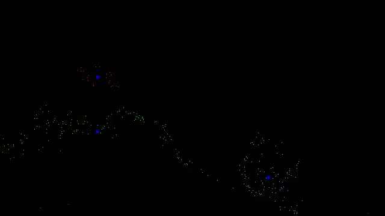
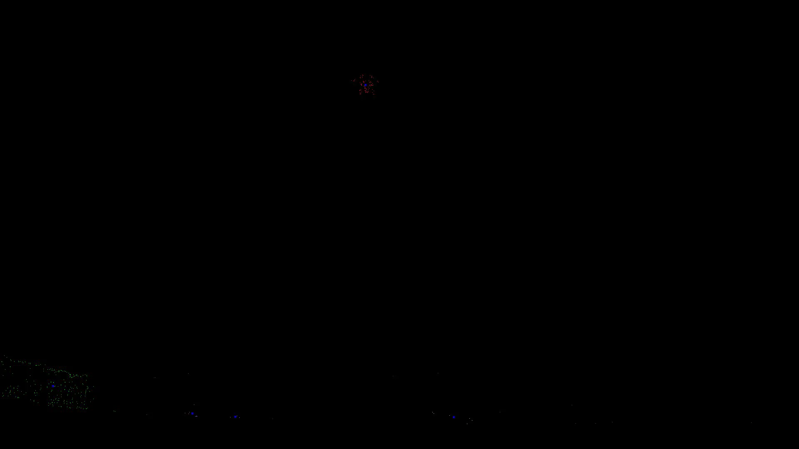
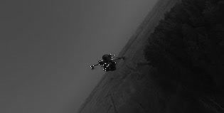
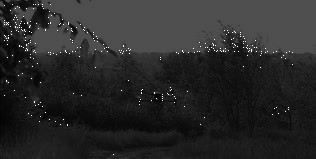
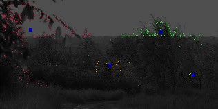

# video stream drone detection

## close FPV



## distant matrice



# principle

## fast9 looks for key points




## dbscan groups them



# than tracking with Kalman filter looks for suspicious dynamics between frames

## compile:
```sh
bear -- make clean compile # helps to setup clang lints
```

## how to use

### parameters
```
-h --help
-c --config          path to config.toml file
-i --input           path to image file or folder containing images path, default in Makefile
-o --output_dir      path to folder for frames output. video goes to default "output" folder
   --output_video    path to video saving location, default output/vidos.mp4
   --dbg_lvl         0 | 1 | 2
```

### examples:
```sh
$ ./bin expl.png
$ ./bin -c config.toml                                       \
        -i $INPUT                                            \
        -o "$INTERMEDIATE_OUTPUT_DIR"                        \
        --dbg_lvl $DBG_LVL                                   \
        --output_video "$INTERMEDIATE_OUTPUT_DIR/vidos.mp4"
```

Folder with images must contain numbered filenames aka 1.jpg, 2.jpg, ...

Then ffmpeg glues video in output folder nearby binary.

## Dependencies for loading & saving (io) image & video demo
### single file libs in include/foreign/
	- [stb_image.h](https://raw.githubusercontent.com/nothings/stb/master/stb_image.h)
	- [stb_image_write.h](https://raw.githubusercontent.com/nothings/stb/master/stb_image_write.h)
	- ffmpeg installed
