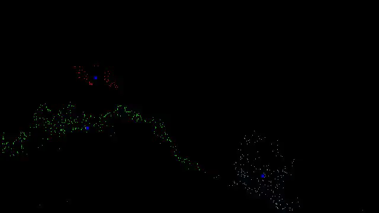
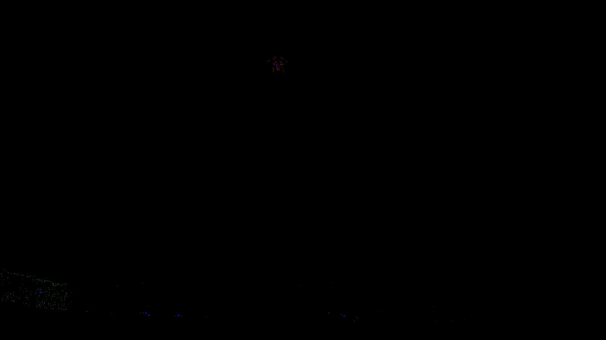

# video stream drone detection

## compile:
```sh
bear -- make clean compile # helps to setup clang lints
```

## use
```
-h --help
-i --input                              path to image file or folder containing images path, default in Makefile
-i --output_dir                         path to folder for frames output. video goes to default "output" folder
   --output_video                       path to video saving location, default output/dildo.mp4
   --dbg_lvl                            0 | 1 | 2
```
examples:
```sh
$ ./bin expl.png
$ ./bin -c config.toml                                       \
        -i $INPUT                                            \
        -o "$INTERMEDIATE_OUTPUT_DIR"                        \
        --dbg_lvl $DBG_LVL                                   \
        --output_video "$INTERMEDIATE_OUTPUT_DIR/vidos.mp4"
```





Folder with images must contain numbered filenames aka 1.jpg, 2.jpg, ...

Then ffmpeg glues video in output folder nearby binary.

## dependencies for loading & saving (io) image
single file libs in include/foreign/

	- stb_image.h
	- stb_image_write.h
	- ffmpeg installed
